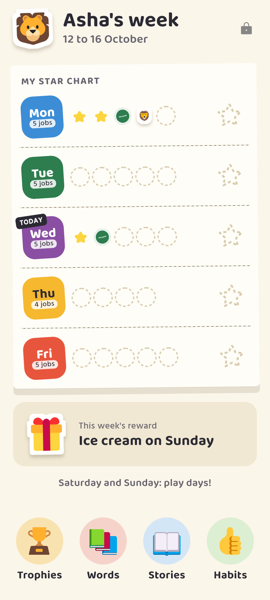
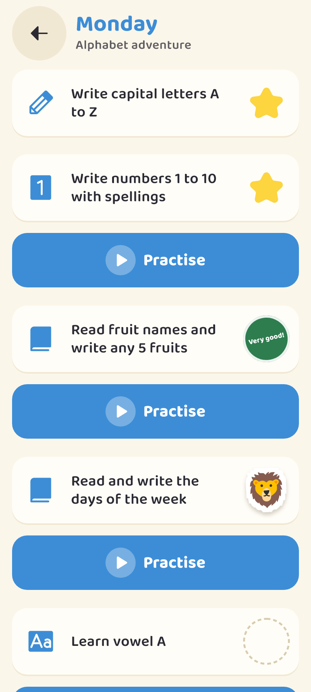
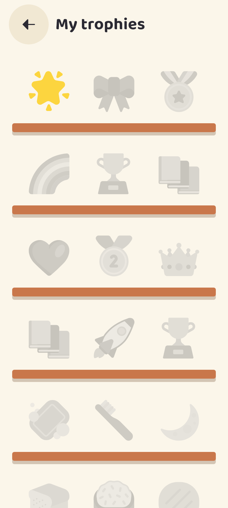
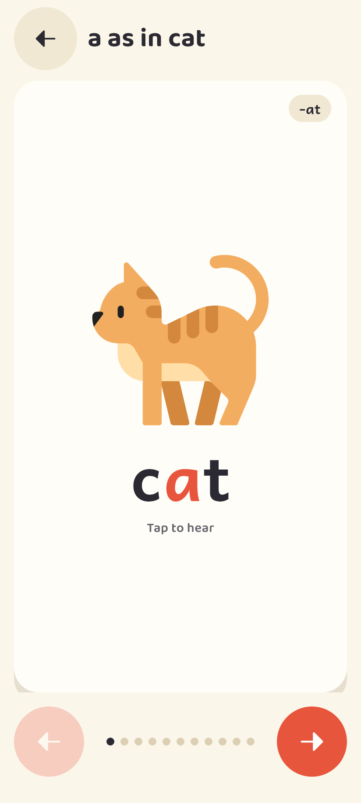
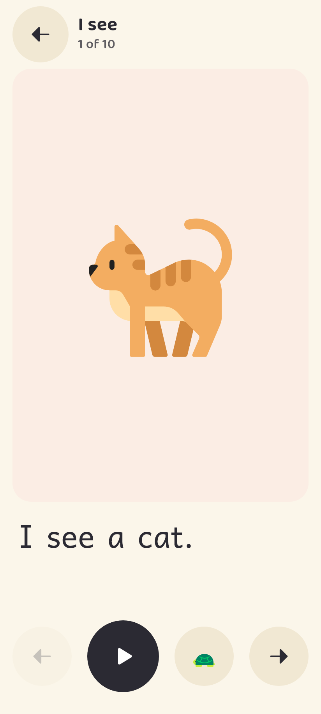
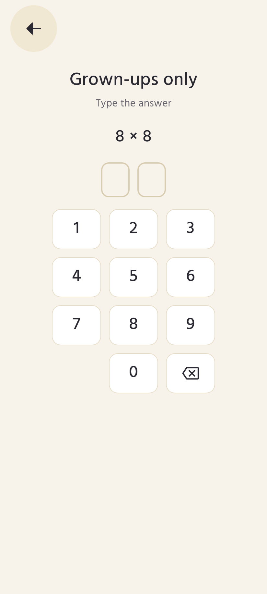
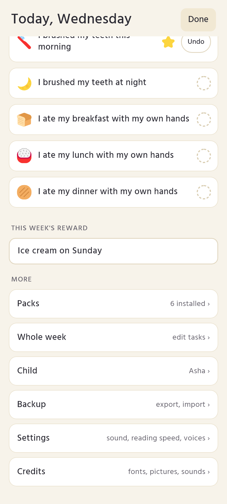

# Starbook

A homework sticker book for preschool children. A parent loads the week's homework sheet, the child does the work, the parent hands out stars, and the child watches the week fill up, collects stickers and puts trophies on a shelf. Picture word books and very short read-along stories sit next to it for practice.

Made for children aged 3 to 6 and the grown-ups helping them. Android first, fully offline.

**Status:** version 0.1.0. Every screen below works and the app runs fully offline on Android. It is not on any store yet.

## What it does

- **This week's page.** Each school day is a big slot that fills with stars as tasks get done. A full week earns the special reward the parent typed in.
- **Awards.** The parent gives a sticker for each finished task. Awards are defined in packs, so they can be renamed or extended.
- **Trophy room.** Milestones (first star, 10 stars, first full week, five stories read) put trophies on a shelf. Trophies are never taken away and there are no streaks to break.
- **Word books.** One word per card with its picture (or a count of pictures), tap to hear it. Short vowels by word family (a: cat, bat, hat, van, fan), "A for apple" sounds, and topic books for fruits, vegetables, flowers, animals, shapes, numbers, counting and Hindi letters.
- **Stories.** Six to ten pages, one short sentence per page in large type. Tap a word to hear it, or press play and watch each word light up as it is read.
- **Parent area** behind a two-digit sum, a difference or a times question a pre-reader cannot answer. Inside: give awards, change this week's tasks, set the child's name and picture, switch sheets, import packs, save a backup to one file and restore it, set sound and reading speed, and check the phone voice.

## Screens

| | |
|---|---|
|  |  |
|  |  |
|  |  |
|  | |

## Packs

Every sheet, word book, story, award and milestone is a JSON pack. Nothing is tied to one school. Write your own by copying a file from [`packs/`](packs), then import it from the parent area or open it with Starbook from WhatsApp, Gmail or Files. A newer revision of the same pack replaces the old one; stars already given stay.

See [Pack format](docs/pack-format.md).

## Privacy

No account, no ads, no analytics, no internet permission. Everything stays on the phone. See [Privacy](docs/privacy.md).

## Docs

- [Product](docs/product.md): what the app does and for whom
- [Design](docs/design.md): look, type, motion, sound, screens and on-screen text
- [Architecture](docs/architecture.md): code layout, database and rules
- [Pack format](docs/pack-format.md): writing your own packs
- [Pictures](docs/pictures.md): the built-in picture names
- [Voice packs](docs/voice-packs.md): recorded voices, and making your own

## Building

Needs Flutter 3.44.6 (stable) and the Android SDK.

```
flutter pub get
dart run build_runner build --delete-conflicting-outputs
flutter run
```

Checks before a pull request:

```
dart format --set-exit-if-changed .
flutter analyze --fatal-infos
flutter test
```

The screenshots above come from the app's own widgets. Refresh them with `flutter test --update-goldens tool/screenshots`. The tool uses a fixed school day, so the day you run it does not matter.

The Play store images come from the same tool. This writes them, with a contact sheet, to the folder given in `out`, best kept outside the repo (default `tmp/store`, which git ignores):

```
flutter test tool/screenshots --plain-name store --dart-define=out=<folder>
```

It needs the Windows font Segoe UI Symbol (`C:/Windows/Fonts/seguisym.ttf`).

## Credits

- Pictures: [Fluent Emoji](https://github.com/microsoft/fluentui-emoji) by Microsoft, MIT licence. A few pictures with no emoji are drawn for this project.
- Stickers: [Noto Animated Emoji](https://googlefonts.github.io/noto-emoji-animation/) by Google, CC BY 4.0, and Fluent Emoji 3D by Microsoft, MIT.
- Icons: [Phosphor Icons](https://phosphoricons.com), MIT.
- Fonts: Baloo 2 (Ek Type), Andika (SIL International), Hind (Indian Type Foundry), all under the SIL Open Font License.
- Sound effects: Kenney, CC0.
- Sticker sounds: animal calls and a celesta twinkle from [Freesound](https://freesound.org), CC0, except the fox: ["Fox, Vocal Cry, Distant, 01.wav"](https://freesound.org/people/InspectorJ/sounds/485009/) by InspectorJ, CC BY 4.0. All were trimmed, level-adjusted and faded. Authors and sources for each file are in [assets/sticker-sounds/CREDITS.md](assets/sticker-sounds/CREDITS.md).
- Voice: recorded with [Kokoro-82M](https://huggingface.co/hexgrad/Kokoro-82M) (Apache-2.0), voice af_heart. The clips are CC0.
- Hindi voice: recorded with [Indic Parler-TTS](https://huggingface.co/ai4bharat/indic-parler-tts) by AI4Bharat (Apache-2.0), speaker Divya. The clips are CC0.

## Licence

Code under the [MIT licence](LICENSE). The default packs are CC0, so you can copy them into your own packs freely.

---

AI coding tools were used to build this app.
